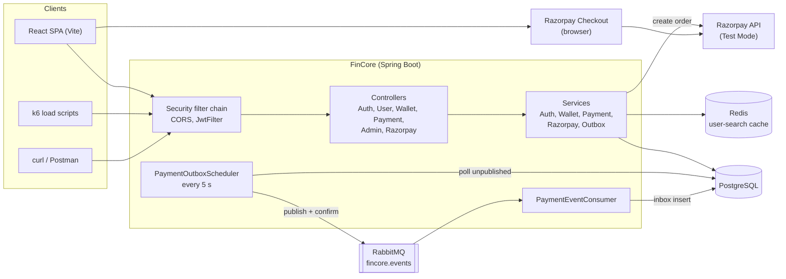
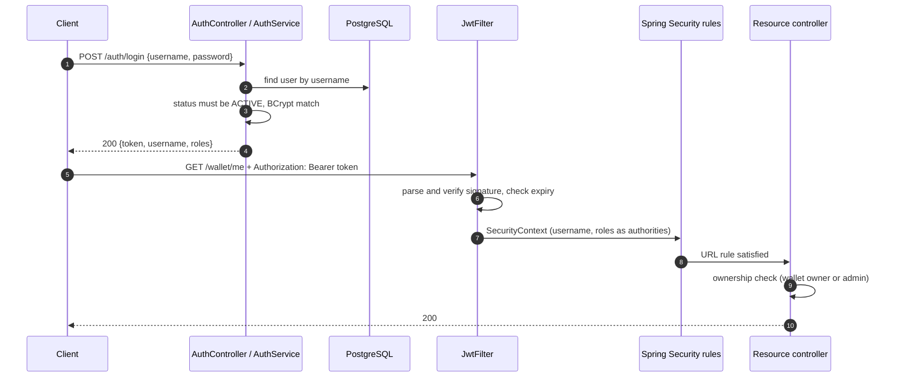
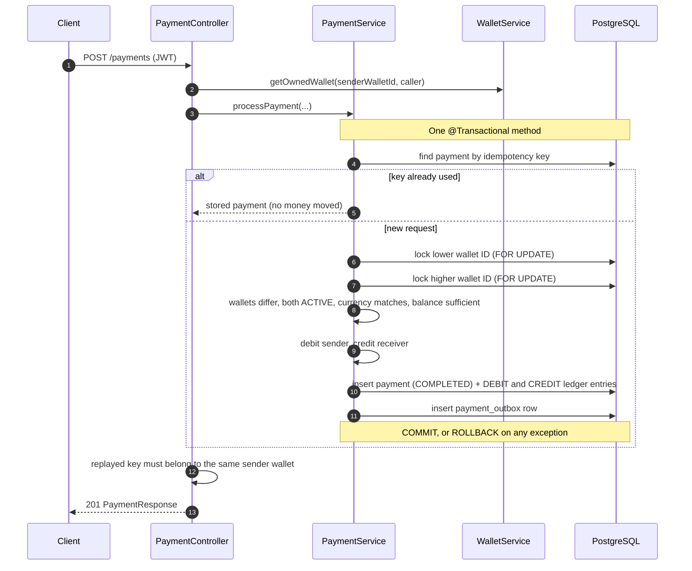
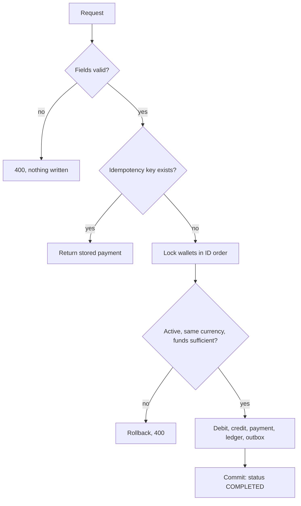
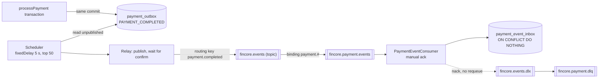
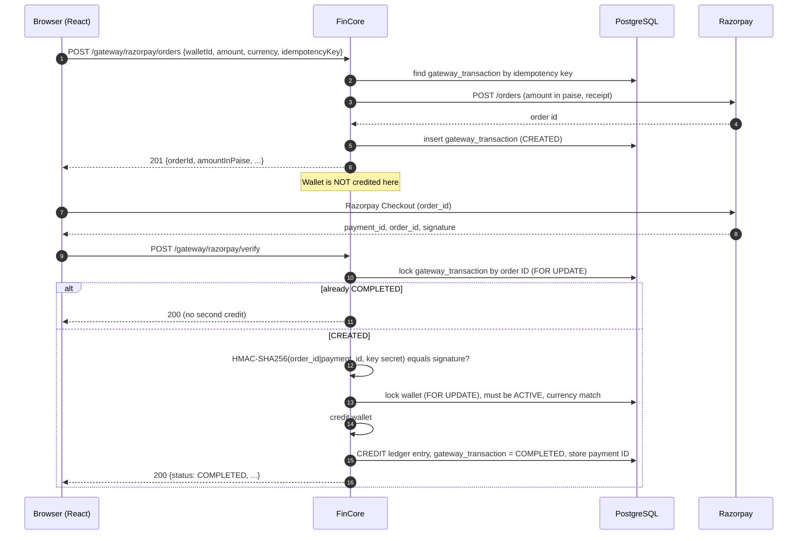
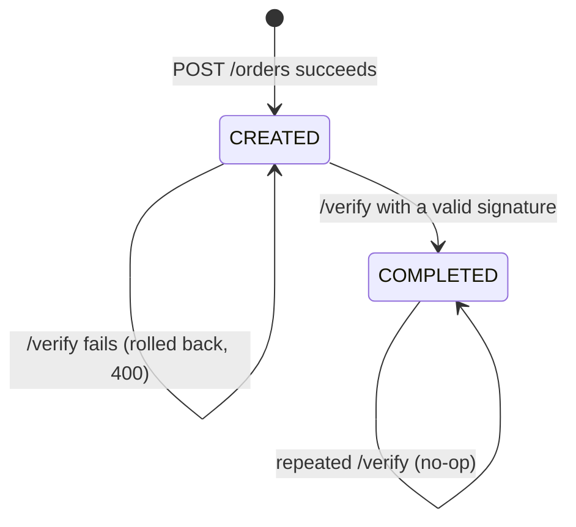
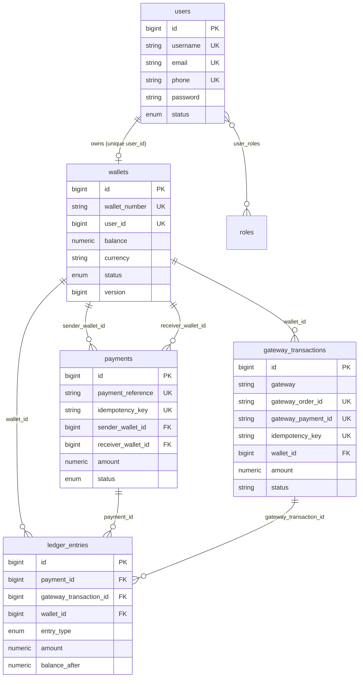
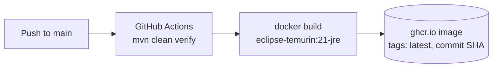

# FinCore — Secure Payment Processing Platform

FinCore is a backend for a wallet-based payment system, built with Java 21 and Spring Boot 4. It handles user registration and JWT authentication, one wallet per user, wallet-to-wallet transfers, wallet funding through the Razorpay Test Mode gateway, and ledger records for balance movements. A small React client is included.

The project concentrates on the parts of a payment backend that are hard to get right:

- keeping balances consistent under concurrent requests (row-level pessimistic locks, `@Version`),
- making retried requests safe (idempotency keys),
- keeping money movement and its records in one database transaction,
- crediting a wallet from an external gateway only after server-side signature verification,
- publishing events reliably with a transactional outbox.

> **Status:** a personal engineering project, developed and benchmarked on a local machine. It is not a production deployment, and this document makes no production-readiness claim. Where behavior is intended but not proven by tests, or exists in code but is not active, the text says so.

---

## Contents

1. [How to read this document](#1-how-to-read-this-document)
2. [Motivation and problem statement](#2-motivation-and-problem-statement)
3. [Key features](#3-key-features)
4. [System architecture](#4-system-architecture)
5. [Technology stack](#5-technology-stack)
6. [Design decisions](#6-design-decisions)
7. [Authentication and authorization](#7-authentication-and-authorization)
8. [Wallet management](#8-wallet-management)
9. [Wallet-to-wallet payment processing](#9-wallet-to-wallet-payment-processing)
10. [Payment idempotency](#10-payment-idempotency)
11. [Transactions and concurrency control](#11-transactions-and-concurrency-control)
12. [Ledger and financial consistency](#12-ledger-and-financial-consistency)
13. [Transactional outbox and messaging](#13-transactional-outbox-and-messaging)
14. [Razorpay integration and gateway transaction lifecycle](#14-razorpay-integration-and-gateway-transaction-lifecycle)
15. [Security design](#15-security-design)
16. [Database design](#16-database-design)
17. [API reference](#17-api-reference)
18. [Request and response examples](#18-request-and-response-examples)
19. [Project structure](#19-project-structure)
20. [Environment configuration](#20-environment-configuration)
21. [Local development setup](#21-local-development-setup)
22. [Running the application](#22-running-the-application)
23. [Testing strategy](#23-testing-strategy)
24. [Performance testing with Grafana k6](#24-performance-testing-with-grafana-k6)
25. [Benchmark results](#25-benchmark-results)
26. [Deployment architecture](#26-deployment-architecture)
27. [Engineering trade-offs and limitations](#27-engineering-trade-offs-and-limitations)
28. [Future improvements](#28-future-improvements)
29. [License](#29-license)
30. [Documentation notes](#30-documentation-notes)

---

## 1. How to read this document

Statements in this README were checked against the source code in this repository. These labels mark the status of a capability:

| Label | Meaning |
|---|---|
| **Implemented** | Present in the code and reachable at runtime. |
| **Present, not active** | Code exists but is disabled or not wired into the running application. |
| **Unverified** | Reported historically (for example, in an earlier README) but not supported by an artifact in this repository. |

A mechanism being **implemented** does not mean it is **proven**. The repository contains no automated concurrency or integration tests (see [Testing strategy](#23-testing-strategy)), so correctness under concurrency rests on code review and on load tests that did not record a financial-integrity check.

---

## 2. Motivation and problem statement

Wallet and payment systems fail in ways that ordinary CRUD applications do not:

| Failure mode | Consequence |
|---|---|
| Two concurrent transfers read the same balance | Lost update; money created or destroyed |
| Two opposite-direction transfers lock wallets in different orders | Deadlock |
| A client retries a request after a timeout | Duplicate debit |
| A debit commits but its record or credit does not | Unreconcilable state |
| A client claims "I paid" to an external gateway | Fraudulent wallet credit |

FinCore's design goal is that money movement stays correct when requests are concurrent, duplicated, or fail midway. [Section 11](#11-transactions-and-concurrency-control) states exactly which of those properties are implemented and what evidence exists for each.

---

## 3. Key features

| Area | Capability | Status |
|---|---|---|
| Authentication | Registration with BCrypt-hashed passwords; username/password login issuing a signed JWT | Implemented |
| Authorization | Role claims in the JWT (`ROLE_USER`, `ROLE_ADMIN`, `ROLE_SUPER_ADMIN`); URL-level rules; per-resource ownership checks in controllers | Implemented |
| Wallets | One INR wallet per user, created at registration; random 12-digit wallet number; `ACTIVE` / `FROZEN` / `CLOSED` states; admin freeze and activate | Implemented |
| Transfers | Wallet-to-wallet payments in a single transaction with ordered pessimistic locks | Implemented |
| Idempotency | Unique idempotency key on payments and on gateway orders | Implemented (see [limits](#10-payment-idempotency)) |
| Ledger | `DEBIT` / `CREDIT` entries with `balance_after` per balance change from transfers and Razorpay funding | Implemented (no read API) |
| Razorpay | Order creation, HMAC-SHA256 signature verification, wallet credit, gateway transaction record | Implemented (Test Mode) |
| Outbox | `payment_outbox` written in the transfer transaction; scheduled relay to RabbitMQ with publisher confirms; inbox deduplication; dead-letter queue | Implemented (consumer only records the event) |
| Search | Recipient search by name, username, phone, user ID or wallet number; Redis-cached | Implemented |
| Rate limiting | In-memory per-IP filter | Present, not active (`@Component` is commented out) |
| Google OAuth2 login | Success handler that provisions a user and issues a JWT | Present, not active (no `oauth2Login()` in the security chain, no client registration properties) |
| Frontend | React + Vite client: sign-in, send, add money, history, dashboard, admin | Implemented |
| CI/CD | GitHub Actions: build, test, push Docker image to GHCR | Implemented |

---

## 4. System architecture



Layering follows the usual Spring convention: controllers validate input and enforce ownership, services hold business rules and transaction boundaries, repositories expose JPA queries (plus one JDBC repository for the inbox table).

---

## 5. Technology stack

| Layer | Technology | Version / source |
|---|---|---|
| Language | Java | 21 (`pom.xml`: `java.version`) |
| Framework | Spring Boot | 4.0.4 (`spring-boot-starter-parent`) |
| Web / validation | `spring-boot-starter-web`, `spring-boot-starter-validation` | managed by Boot |
| Security | `spring-boot-starter-security`, BCrypt | managed by Boot |
| JWT | `jjwt-api` / `jjwt-impl` / `jjwt-jackson` | 0.11.5 |
| Persistence | `spring-boot-starter-data-jpa` (Hibernate), PostgreSQL driver | managed by Boot |
| Cache | `spring-boot-starter-cache` + `spring-boot-starter-data-redis` | managed by Boot; 5-minute TTL |
| Messaging | `spring-boot-starter-amqp` (RabbitMQ) | managed by Boot |
| OAuth2 client | `spring-boot-starter-oauth2-client` | on classpath, not wired |
| Payment gateway | Razorpay Orders REST API via Spring `RestClient` (no Razorpay SDK) | Test Mode |
| Frontend | React `^18.3.1`, react-router-dom `^6.26.2`, Vite `^5.4.8` | `fincore-frontend/package.json` |
| Container | `eclipse-temurin:21-jre` | `Dockerfile` |
| CI/CD | GitHub Actions, GitHub Container Registry | `.github/workflows/ci-cd.yml` |
| Load testing | Grafana k6 | `payment-load.js`, `razorpay-load-test.js` |

---

## 6. Design decisions

| Decision | Reason | Where |
|---|---|---|
| All balance changes run inside one `@Transactional` service method | Debit, credit, payment row, ledger rows and outbox row commit or roll back together | `PaymentService.processPayment`, `RazorpayService.verifyPayment` |
| `SELECT ... FOR UPDATE` on wallet rows (`PESSIMISTIC_WRITE`) | Serializes writers per wallet so read-check-write on a balance cannot interleave | `WalletRepository.findByIdForUpdate` |
| Lock wallets in ascending ID order | A fixed global lock order prevents lock-cycle deadlocks between opposite transfers | `PaymentService.processPayment` |
| `@Version` on `Wallet` | Optimistic detection as a second line of defense against an unlocked write path | `Wallet.version` |
| Idempotency key stored on the payment row with a unique constraint declared on the entity | Retries return the stored result instead of moving money again | `Payment.idempotencyKey` |
| Gateway transactions in their own table | External payment state is separate from internal transfers and can be reconciled against the provider | `GatewayTransaction` |
| Lock the gateway transaction row before crediting | Two concurrent `verify` calls cannot both credit | `findByGatewayOrderIdForUpdate` |
| Transactional outbox | The event is written in the same transaction as the payment, so a crash cannot commit a payment and lose its event | `PaymentOutboxService` |
| Inbox table with `ON CONFLICT DO NOTHING` | At-least-once delivery becomes effectively-once processing for the consumer | `PaymentEventInboxRepository` |
| `BigDecimal` / `NUMERIC(19,2)` for money | No floating-point rounding | entity column definitions |
| Razorpay amounts converted with `RoundingMode.UNNECESSARY` | Fails loudly instead of silently rounding paise | `RazorpayClient.createOrder` |

---

## 7. Authentication and authorization

### Flow



### Details

| Item | Implementation |
|---|---|
| Password storage | `BCryptPasswordEncoder` (default strength) |
| Token | JWT, subject = username, claim `roles`, signed with the key derived from `jwt.secret`; the issued tokens in the repository use `HS256` |
| Lifetime | `jwt.expiration=86400000` ms (24 hours), fixed in `application.properties` |
| Secret | `JWT_SECRET` env var; a development default is present in `application.properties` and must be overridden |
| Session | Stateless; CSRF disabled |
| Invalid token | `JwtFilter` clears the context and continues; the request is then treated as unauthenticated |

### Access rules (`SecurityConfig`)

| Path | Access |
|---|---|
| `OPTIONS /**` | Public (CORS preflight) |
| `/auth/register`, `/auth/login`, `/razorpay.html` | Public |
| `/admin/**` | `ROLE_ADMIN` or `ROLE_SUPER_ADMIN` |
| `/wallet/**`, `/payments/**`, `/gateway/razorpay/**`, `/ledger/**`, anything else | Authenticated |

The `/ledger/**` rule exists, but no controller is mapped to it.

On top of URL rules, controllers enforce **ownership**: a payment's sender wallet must belong to the caller; wallets and payments are readable only by their participants or an admin.

Known behavior of the stateless JWT design: roles are read from the token, so a role change takes effect only when the token expires; and the user's `status` is checked at login but not on later requests.

---

## 8. Wallet management

- Registration creates the user and the wallet in the same transaction (`AuthService.register` → `WalletService.createWallet`). `GET /wallet/me` also creates a wallet if none exists.
- Wallet number: 12 random digits from `SecureRandom`, regenerated until unique.
- Defaults: balance `0.00`, currency `INR`, status `ACTIVE`.
- States: `ACTIVE`, `FROZEN`, `CLOSED`. Debits and credits require `ACTIVE`. A `CLOSED` wallet cannot be frozen or activated.
- Freeze and activate lock the wallet row (`findByIdForUpdate`) and are exposed to admins under `/admin/wallets/{walletId}/...`.
- **Direct funding** (`POST /wallet/{walletId}/fund`) adds to a balance with no payment record, gateway record or ledger entry. It is allowed for admins, and for the wallet owner only when `fincore.dev-funding-enabled=true`. **The committed `application.properties` sets this to `true`**; set it to `false` outside local development.

---

## 9. Wallet-to-wallet payment processing



Validation order inside `processPayment`: request fields, idempotency lookup, ordered locks, sender ≠ receiver, both wallets `ACTIVE`, currency match with the request, sufficient balance. Any failure throws a `RuntimeException`, which rolls the transaction back, so a partial debit cannot persist.

### Payment status

`PaymentStatus` defines `CREATED`, `PROCESSING`, `SUCCESS`, `FAILED` and `COMPLETED`. The transfer path creates the payment as `CREATED` in the constructor and sets `COMPLETED` before the single save. In practice only `COMPLETED` is persisted; failed transfers roll back and leave no row. The other statuses are not used by current code.



---

## 10. Payment idempotency

**Mechanism.** Every payment request carries `idempotencyKey` (max 100 chars). `processPayment` looks the key up first and, if found, returns the stored payment without touching balances. The same pattern applies to Razorpay order creation (`GatewayTransaction.idempotencyKey`).

**What this provides**

- A client that retries after a timeout receives the original result rather than a second debit.
- `PaymentController` checks that a replayed payment belongs to the caller's sender wallet, so one user cannot read another user's payment by reusing a key.

**Limits to be aware of**

| Limit | Detail |
|---|---|
| No request fingerprint | A reused key with a *different* amount or receiver returns the original payment instead of being rejected. |
| Replay status code | A replay returns `201 Created` like the first call; the response does not indicate it is a replay. |
| Concurrent duplicates | The lookup is a read before the locks. Two simultaneous requests with the same new key can both pass it. The second then waits for the wallet locks, and its insert would violate the unique constraint on `payments.idempotency_key`, rolling back its whole transaction (including its debit). **This safety net exists only if the database actually has that unique constraint.** The schema is not versioned in this repository (see [Database design](#16-database-design)), and `ddl-auto=validate` does not check constraints. |
| Gateway orders | Same read-then-insert pattern. A concurrent duplicate could create an extra Razorpay order before the unique constraint rejects the local row; the extra order remains unused at Razorpay. |

---

## 11. Transactions and concurrency control

### Why transactions are required

A transfer changes four kinds of state: the sender balance, the receiver balance, the payment record, and the ledger/outbox rows. If any of them could commit without the others, the system would be inconsistent. `processPayment` is a single `@Transactional` method (default propagation), so Spring opens one database transaction, and an unchecked exception rolls all of it back. Isolation is not configured and therefore is the database default (PostgreSQL: `READ COMMITTED`).

### Pessimistic locking

`WalletRepository.findByIdForUpdate` is annotated `@Lock(LockModeType.PESSIMISTIC_WRITE)`, which Hibernate issues as `SELECT ... FOR UPDATE` on PostgreSQL. A second transaction that tries to lock the same wallet blocks until the first commits or rolls back. Because the balance is read after the lock is held, the check-then-update on the balance cannot interleave with another writer. `getWalletForUpdate` is `@Transactional` and joins the caller's transaction; the lock lasts until that transaction ends.

### Deterministic lock order

```java
if (senderWalletId < receiverWalletId) {
    senderWallet   = walletService.getWalletForUpdate(senderWalletId);
    receiverWallet = walletService.getWalletForUpdate(receiverWalletId);
} else {
    receiverWallet = walletService.getWalletForUpdate(receiverWalletId);
    senderWallet   = walletService.getWalletForUpdate(senderWalletId);
}
```

If A→B and B→A ran concurrently and each locked its own sender first, each would hold one lock and wait for the other: a deadlock. Always locking the lower ID first means both transactions request the same lock first, so one waits and the other proceeds; no cycle can form among transfers.

Other lock-taking paths do not invert this order: Razorpay `verify` locks the gateway-transaction row and then one wallet; freeze/activate lock one wallet. No path locks a wallet and then waits on a gateway-transaction row.

### Optimistic versioning

`Wallet.version` is a JPA `@Version` column. Hibernate adds `AND version = ?` to wallet updates and increments it, and throws an optimistic-lock exception if the row changed underneath. Every balance-changing path in the code takes the pessimistic lock first, so version conflicts are not expected in normal operation; the field is a safety net for any future path that forgets to lock.

### Implemented versus proven

| Property | Mechanism | Status |
|---|---|---|
| No lost balance update between concurrent transfers | Row locks, balance read under lock | Implemented. Not covered by an automated concurrency test. |
| No deadlock between opposite-direction transfers | Ascending-ID lock order | Implemented by construction for the transfer path. Not tested. |
| Debit, credit, payment, ledger and outbox are atomic | One `@Transactional` method | Implemented. |
| Sequential retry does not repeat a transfer | Idempotency lookup | Implemented. |
| Concurrent duplicate does not repeat a transfer | Unique constraint as backstop | Depends on a DB constraint that is not in the repository. |
| Ledger always reconciles to balances | — | **Not guaranteed** (see [Ledger](#12-ledger-and-financial-consistency)). |
| Behavior at scale | — | Not established; see [Benchmark results](#25-benchmark-results). |

Not configured: lock-wait timeouts, retry on lock failure, or deadlock-specific handling. A lock timeout or a unique-constraint failure would surface as a generic `400 Bad Request` through the `RuntimeException` handler.

---

## 12. Ledger and financial consistency

`ledger_entries` rows are written in two situations:

| Event | Entries |
|---|---|
| Internal transfer | One `DEBIT` (sender) and one `CREDIT` (receiver), both linked to the payment, each with `balance_after` |
| Razorpay funding | One `CREDIT` linked to the gateway transaction, with `balance_after` |

Entries record `amount`, `entry_type`, the wallet, and `balance_after` taken from the locked wallet after the change.

**What this is and is not**

- It is a per-wallet movement log written in the same transaction as the balance change.
- It is *double-entry-style* for transfers (a matching debit and credit). It is not a full double-entry system: there is no chart of accounts, and gateway funding has no offsetting entry.
- Entries are described in code comments as immutable, but the entity has setters and nothing in the repository enforces append-only behavior at the database level.
- Direct funding (`POST /wallet/{id}/fund`) changes a balance **without** a ledger entry, so with that path enabled, ledger totals can diverge from balances. No reconciliation job exists.
- `LedgerEntryRepository` has query methods (by wallet, payment, gateway transaction), but no controller exposes them.

---

## 13. Transactional outbox and messaging



**Producer side.** `PaymentOutboxService.recordPaymentCompleted` runs inside the payment transaction and inserts a `payment_outbox` row (event ID, aggregate type/ID, event type, JSON payload, attempts, last error). If serialization fails it throws, rolling back the payment. A scheduler polls the 50 oldest unpublished rows every 5 seconds. The relay publishes a persistent message, waits up to 10 seconds for a publisher confirm, treats a negative confirm or an unroutable return as failure, and then sets `published_at`; on failure it increments `attempts` and records `last_error`.

**Consumer side.** The listener (2–5 concurrent consumers, manual acknowledgement) inserts the event into `payment_event_inbox` with `ON CONFLICT (event_id) DO NOTHING`, then acknowledges. Unparseable or failing messages are rejected without requeue and go to the dead-letter queue.

**Guarantees and boundaries**

- Delivery is **at-least-once**: a crash between a confirmed publish and `markPublished` republishes the event; the inbox absorbs duplicates by event ID.
- The consumer currently records and logs the event; no downstream business action (notification, analytics, etc.) is attached.
- The poller does not lock rows, so multiple app instances could publish the same row; the inbox makes that harmless but wasteful.
- Only internal transfers emit events; Razorpay funding does not.
- There is no cap on `attempts`, no purge of published outbox rows or inbox rows, and no dead-letter reprocessing.

---

## 14. Razorpay integration and gateway transaction lifecycle

FinCore uses Razorpay **Test Mode** to fund wallets. The backend talks to `https://api.razorpay.com/v1` with HTTP Basic credentials from `RAZORPAY_KEY_ID` / `RAZORPAY_KEY_SECRET`. These stay on the server. The browser needs only the public key ID to open Checkout; the React client reads it from `VITE_RAZORPAY_KEY_ID`.



### Why signature verification prevents fraudulent credits

After a successful payment, Razorpay signs `order_id|payment_id` with the account's key secret. Only a party holding that secret can produce a valid signature. `RazorpayClient.verifyPaymentSignature` recomputes the HMAC-SHA256 with the server-side secret and compares it to the client-supplied signature using `MessageDigest.isEqual` (constant-time). A client that submits an arbitrary payment ID cannot produce a matching signature, so the wallet is not credited. The credited amount and wallet come from the stored `gateway_transaction`, not from the request.

### Gateway transactions versus internal transfers

| | Internal transfer | Razorpay funding |
|---|---|---|
| Table | `payments` | `gateway_transactions` |
| Money source | Another wallet (debit + credit) | External payment (credit only) |
| Guard against duplicates | Idempotency key + unique constraint | Idempotency key, unique order ID, row lock + status check |
| Ledger | `DEBIT` + `CREDIT`, linked to payment | `CREDIT`, linked to gateway transaction |
| Outbox event | Yes | No |
| Trust boundary | Authenticated user | Razorpay signature |

### Gateway transaction lifecycle



`GatewayTransaction.status` is a plain string; only `CREATED` and `COMPLETED` are ever set. There is no `FAILED` or expired state, no Razorpay webhook endpoint, and no reconciliation against Razorpay. If a client never calls `/verify` after paying, the wallet is not credited.

### Test Mode setup

1. Create a Razorpay account and switch the dashboard to **Test Mode**.
2. Generate API keys under the dashboard's API key settings. Copy the Key ID (it begins `rzp_test_`) and the Key Secret.
3. Export `RAZORPAY_KEY_ID` and `RAZORPAY_KEY_SECRET` for the backend, and set `VITE_RAZORPAY_KEY_ID` for the frontend.
4. Pay in Checkout with Razorpay's documented test payment methods. No real money moves in Test Mode.

`src/main/resources/static/razorpay.html` is a standalone manual test page served at `/razorpay.html`. Replace the key ID hard-coded in that file with your own before using it.

---

## 15. Security design

| Control | Implementation |
|---|---|
| Password hashing | BCrypt |
| Registration validation | Bean Validation (`@NotBlank`, `@Email`, size limits, password 8–100 chars); phone normalized and matched against `\+?\d{7,14}`; email lowercased; uniqueness checked for username, email and phone |
| Authentication | Stateless JWT bearer tokens |
| Authorization | URL rules by role plus ownership checks in controllers; `AccessDeniedException` returns `403` |
| Data minimization | User search returns a masked phone (`•••••• 1234`) and never the email; query max 50 chars, max 10 results, LIKE wildcards escaped |
| Gateway integrity | Server-side HMAC-SHA256 verification, constant-time compare, row lock, status check |
| Secrets handling | JWT secret, Razorpay secret, Redis and RabbitMQ credentials are read from environment variables; `.env` is git-ignored |
| CORS | Allow-list of `localhost:5173`, `:3000`, `:4200` and a placeholder Vercel origin (`https://YOUR-ACTUAL-FRONTEND.vercel.app`); credentials allowed |
| Money handling | `BigDecimal`, `NUMERIC(19,2)`, exact paise conversion |

**Known gaps** are collected in [Engineering trade-offs and limitations](#27-engineering-trade-offs-and-limitations). The main ones: development defaults for secrets and credentials in `application.properties`, direct funding enabled by default, no wallet-ownership check on the Razorpay endpoints, tokens that cannot be revoked, and the frontend keeping the JWT in `localStorage`.

---

## 16. Database design

PostgreSQL is the system of record. Hibernate runs with `spring.jpa.hibernate.ddl-auto=validate`: the application **does not create or migrate the schema**.



Two tables have no foreign keys and are not shown: `payment_outbox` (UUID primary key) and `payment_event_inbox` (accessed with JDBC, keyed by `event_id`).

**Schema is not included in this repository.** The required objects, derived from the entity classes and `JdbcTemplate` SQL, are:

- Tables: `users`, `roles`, `user_roles`, `wallets`, `payments`, `gateway_transactions`, `ledger_entries`, `payment_outbox`, `payment_event_inbox`.
- PostgreSQL enum types for the `@JdbcTypeCode(SqlTypes.NAMED_ENUM)` columns: user status, wallet status, payment status, ledger entry type.
- Constraints the application logic relies on: unique `payments.idempotency_key`, `payments.payment_reference`, `wallets.wallet_number`, `wallets.user_id`, and the unique constraints declared on `gateway_transactions`.
- Seed rows in `roles` for `ROLE_USER`, `ROLE_ADMIN`, `ROLE_SUPER_ADMIN` (registration fails without `ROLE_USER`).

Exact DDL is not provided here because it cannot be verified from the source alone; Hibernate's `validate` step will report mismatches at startup. Adding versioned migrations is listed under [Future improvements](#28-future-improvements).

---

## 17. API reference

Base URL (default): `http://localhost:8081`. There is no Swagger/OpenAPI dependency, so no generated API documentation URL exists. The Postman files in the repository (`postman_collection.json`, `postman/`) describe an older project (`/transactions`, `/dashboard/*`) and are **not** a reference for this API.

Authenticated endpoints require `Authorization: Bearer <jwt>`.

### Authentication

| Method | Path | Auth | Description |
|---|---|---|---|
| POST | `/auth/register` | Public | Create a user and a wallet. `201`, plain-text body |
| POST | `/auth/login` | Public | Returns `{token, username, roles}` |

### Users

| Method | Path | Auth | Description |
|---|---|---|---|
| GET | `/users/search?q=` | User | Find payable recipients by name, username, phone, user ID or wallet number. Excludes the caller; ≤ 10 results |

### Wallets

| Method | Path | Auth | Description |
|---|---|---|---|
| GET | `/wallet/me` | User | Caller's wallet (created if missing) |
| GET | `/wallet/{walletNumber}` | Owner or admin | Wallet by 12-digit wallet number |
| GET | `/wallet/{walletId}/balance` | Owner or admin | Balance as a bare number |
| POST | `/wallet/{walletId}/fund?amount=` | Admin; owner only if `fincore.dev-funding-enabled=true` | Direct credit, no ledger entry |

### Payments

| Method | Path | Auth | Description |
|---|---|---|---|
| POST | `/payments` | User (sender wallet owner) | Wallet-to-wallet transfer. `201` |
| GET | `/payments/me?limit=` | User | Caller's payment history; `limit` default 50, clamped to 1–200 |
| GET | `/payments/{id}` | Participant or admin | Payment by ID |
| GET | `/payments/idempotency/{key}` | Participant or admin | Payment by idempotency key |

### Razorpay gateway

| Method | Path | Auth | Description |
|---|---|---|---|
| POST | `/gateway/razorpay/orders` | Authenticated | Create a Razorpay order and a `CREATED` gateway transaction. `201` |
| POST | `/gateway/razorpay/verify` | Authenticated | Verify the signature and credit the wallet. `200` |

### Administration

| Method | Path | Auth | Description |
|---|---|---|---|
| GET | `/admin/wallets/{walletId}` | Admin | Wallet details |
| POST | `/admin/wallets/{walletId}/freeze` | Admin | Set status `FROZEN` |
| POST | `/admin/wallets/{walletId}/activate` | Admin | Set status `ACTIVE` |

There is no endpoint to grant roles. Admin users are created by inserting into `user_roles`.

### Static

| Method | Path | Auth | Description |
|---|---|---|---|
| GET | `/razorpay.html` | Public | Manual Razorpay Checkout test page |

### Error format

All handled errors use this body:

```json
{
  "timestamp": "2026-11-01T18:30:00.123",
  "status": 400,
  "error": "Bad Request",
  "message": "Insufficient wallet balance",
  "path": "/payments"
}
```

| Status | Source |
|---|---|
| `400` | Bean Validation failures (`error: "Validation Failed"`, field messages joined) **and every business-rule `RuntimeException`**: insufficient balance, wallet not found, wallet not active, currency mismatch, invalid signature, invalid credentials, duplicate username/email/phone |
| `403` | `AccessDeniedException` (not owner, direct funding disabled, URL rule denies the role) |
| `500` | Any other unhandled exception |

All business failures map to `400`; the API does not use `404` or `409`. The response a client receives for a missing or expired token depends on Spring Security's default entry point (no custom one is configured) and was not verified by running the application.

---

## 18. Request and response examples

Values are illustrative.

### Register and log in

```bash
curl -X POST http://localhost:8081/auth/register \
  -H "Content-Type: application/json" \
  -d '{
    "firstName": "Asha",
    "lastName": "Rao",
    "username": "asha",
    "email": "asha@example.com",
    "phone": "9876543210",
    "password": "a-strong-password"
  }'
```

`201 Created`, body (plain text):

```text
User Registered Successfully. Wallet created successfully.
```

```bash
curl -X POST http://localhost:8081/auth/login \
  -H "Content-Type: application/json" \
  -d '{"username": "asha", "password": "a-strong-password"}'
```

```json
{
  "token": "<jwt>",
  "username": "asha",
  "roles": ["ROLE_USER"]
}
```

### Get my wallet

```bash
curl http://localhost:8081/wallet/me -H "Authorization: Bearer $TOKEN"
```

```json
{
  "id": 3,
  "userId": 3,
  "walletNumber": "493017284650",
  "balance": 1000.00,
  "currency": "INR",
  "status": "ACTIVE"
}
```

### Search for a recipient

```bash
curl "http://localhost:8081/users/search?q=ravi" -H "Authorization: Bearer $TOKEN"
```

```json
[
  {
    "userId": 4,
    "walletId": 4,
    "walletNumber": "120945837712",
    "displayName": "Ravi K",
    "username": "ravi",
    "maskedPhone": "•••••• 3210"
  }
]
```

### Create a payment

```bash
curl -X POST http://localhost:8081/payments \
  -H "Authorization: Bearer $TOKEN" \
  -H "Content-Type: application/json" \
  -d '{
    "senderWalletId": 3,
    "receiverWalletId": 4,
    "amount": 250.00,
    "currency": "INR",
    "idempotencyKey": "pay-asha-ravi-0001",
    "description": "Lunch"
  }'
```

`201 Created`:

```json
{
  "id": 17,
  "paymentReference": "PAY-4F9C2A7B1D3E8A5C6B20",
  "idempotencyKey": "pay-asha-ravi-0001",
  "senderWalletId": 3,
  "receiverWalletId": 4,
  "amount": 250.00,
  "currency": "INR",
  "status": "COMPLETED",
  "description": "Lunch",
  "createdAt": "2026-11-01T18:30:00.123",
  "completedAt": "2026-11-01T18:30:00.140"
}
```

Repeating the identical request returns the same payment and moves no money.

Validation rules (`PaymentRequest`): both wallet IDs required, `amount` ≥ `0.01`, `currency` exactly 3 characters, `idempotencyKey` required and ≤ 100 characters.

### Payment history

```bash
curl "http://localhost:8081/payments/me?limit=20" -H "Authorization: Bearer $TOKEN"
```

```json
[
  {
    "id": 17,
    "paymentReference": "PAY-4F9C2A7B1D3E8A5C6B20",
    "direction": "SENT",
    "counterpartyWalletId": 4,
    "counterpartyName": "Ravi K",
    "amount": 250.00,
    "currency": "INR",
    "status": "COMPLETED",
    "description": "Lunch",
    "createdAt": "2026-11-01T18:30:00.123",
    "completedAt": "2026-11-01T18:30:00.140"
  }
]
```

### Create a Razorpay order

```bash
curl -X POST http://localhost:8081/gateway/razorpay/orders \
  -H "Authorization: Bearer $TOKEN" \
  -H "Content-Type: application/json" \
  -d '{
    "walletId": 3,
    "amount": 1000.00,
    "currency": "INR",
    "idempotencyKey": "rzp-asha-0001",
    "description": "FinCore wallet funding"
  }'
```

Validation: `amount` ≥ `1.00`; the wallet must be `ACTIVE` and in the same currency.

`201 Created`:

```json
{
  "gateway": "RAZORPAY",
  "orderId": "order_xxxxxxxxxxxxxx",
  "walletId": 3,
  "amount": 1000.00,
  "amountInPaise": 100000,
  "currency": "INR",
  "status": "created",
  "idempotencyKey": "rzp-asha-0001"
}
```

### Verify the payment

After Checkout succeeds, send the three values Razorpay returns:

```bash
curl -X POST http://localhost:8081/gateway/razorpay/verify \
  -H "Authorization: Bearer $TOKEN" \
  -H "Content-Type: application/json" \
  -d '{
    "razorpayOrderId": "order_xxxxxxxxxxxxxx",
    "razorpayPaymentId": "pay_xxxxxxxxxxxxxx",
    "razorpaySignature": "<signature-from-checkout>"
  }'
```

`200 OK`:

```json
{
  "status": "COMPLETED",
  "gateway": "RAZORPAY",
  "gatewayOrderId": "order_xxxxxxxxxxxxxx",
  "gatewayPaymentId": "pay_xxxxxxxxxxxxxx",
  "walletId": 3,
  "amount": 1000.00
}
```

An invalid signature returns `400` with `"message": "Invalid Razorpay payment signature"` and credits nothing.

### Common errors

```json
{
  "timestamp": "2026-11-01T18:31:10.512",
  "status": 403,
  "error": "Forbidden",
  "message": "You do not have access to this wallet",
  "path": "/payments"
}
```

---

## 19. Project structure

```text
.
├── pom.xml                         # Maven build (Spring Boot 4.0.4, Java 21)
├── mvnw, mvnw.cmd                  # Maven wrapper
├── Dockerfile                      # JRE 21 image; copies target/*.jar
├── .github/workflows/ci-cd.yml     # Build, test, push image to GHCR
├── payment-load.js                 # k6: internal transfer load test
├── razorpay-load-test.js           # k6: Razorpay order-creation test
├── payment-results.json            # Committed k6 summary export (see §25)
├── fincore-frontend/               # React + Vite client
│   └── src/{api.js, auth.jsx, wallet.jsx, pages/*}
├── src/main/java/com/fincore/backend/
│   ├── FinCoreApplication.java
│   ├── controller/                 # Auth, User, Wallet, Payment, Admin
│   ├── gateway/                    # Razorpay controller, service, client, config, entity, DTOs
│   ├── service/                    # Auth, Wallet, Payment, outbox, event processing, user search
│   ├── messaging/                  # RabbitMQ topology and consumer
│   ├── repository/                 # JPA repositories + JDBC inbox repository
│   ├── entity/  enums/  dto/       # Domain model and DTOs
│   ├── security/                   # SecurityConfig, JwtFilter, JwtUtil, OAuth2 handler (unused)
│   ├── cache/                      # Redis cache key generator
│   ├── ratelimit/                  # RateLimitFilter (disabled)
│   └── exception/                  # GlobalExceptionHandler, ErrorResponse
├── src/main/resources/
│   ├── application.properties
│   └── static/razorpay.html        # Manual Checkout test page
├── src/test/java/...               # Context and connection tests
├── postman_collection.json, postman/   # Legacy; does not describe this API
├── wallet-concurrency-audit.txt    # Source snapshot of an earlier version (not test output)
└── fincore-integration-files.txt   # Source snapshot of an earlier version
```

---

## 20. Environment configuration

Spring Boot reads these from the process environment. The application does not load `.env` files itself; export the variables (or use your IDE, `docker run --env-file`, etc.). `.env` is git-ignored.

| Variable | Used for | Default in `application.properties` |
|---|---|---|
| `SERVER_PORT` | HTTP port | `8081` |
| `APP_NAME` | `spring.application.name` | `fincore` |
| `JWT_SECRET` | JWT signing key (must be at least 32 bytes) | Development value present; **override it** |
| `RAZORPAY_KEY_ID` | Razorpay Basic-auth user | None (**required**) |
| `RAZORPAY_KEY_SECRET` | Razorpay Basic-auth password and signature key | None (**required**) |
| `REDIS_HOST`, `REDIS_PORT` | Redis connection | `localhost`, `6379` |
| `REDIS_PASSWORD` | Redis password | Placeholder default present; override |
| `RABBITMQ_HOST`, `RABBITMQ_PORT` | RabbitMQ connection | `localhost`, `5672` |
| `RABBITMQ_USERNAME`, `RABBITMQ_PASSWORD` | RabbitMQ credentials | Broker defaults present; override |
| `RABBITMQ_VHOST` | Virtual host | `/` |

The database URL, username and password are **hard-coded** in `application.properties` (`localhost:5432/fincore`). Override them with Spring Boot's standard property-to-environment mapping: `SPRING_DATASOURCE_URL`, `SPRING_DATASOURCE_USERNAME`, `SPRING_DATASOURCE_PASSWORD`. Similarly, `jwt.expiration` is fixed at 24 hours, and `fincore.dev-funding-enabled` is read as a property; pass it as `--fincore.dev-funding-enabled=false` on the command line.

Frontend variables (`fincore-frontend`):

| Variable | Used for |
|---|---|
| `VITE_API_URL` | API base path; defaults to `/api` (proxied in dev) |
| `VITE_BACKEND_URL` | Dev-proxy target in `vite.config.js`; defaults to `http://localhost:8080` |
| `VITE_RAZORPAY_KEY_ID` | Razorpay public key ID for Checkout |

Template (copy to `.env` and fill in; placeholders only):

```dotenv
# Server
SERVER_PORT=8081
APP_NAME=fincore

# Security
JWT_SECRET=<random-string-of-at-least-32-bytes>

# Razorpay (Test Mode keys)
RAZORPAY_KEY_ID=rzp_test_<your-key-id>
RAZORPAY_KEY_SECRET=<your-key-secret>

# Redis
REDIS_HOST=localhost
REDIS_PORT=6379
REDIS_PASSWORD=<redis-password>

# RabbitMQ
RABBITMQ_HOST=localhost
RABBITMQ_PORT=5672
RABBITMQ_USERNAME=<rabbitmq-user>
RABBITMQ_PASSWORD=<rabbitmq-password>
RABBITMQ_VHOST=/

# PostgreSQL (Spring Boot standard overrides)
SPRING_DATASOURCE_URL=jdbc:postgresql://localhost:5432/fincore
SPRING_DATASOURCE_USERNAME=<db-user>
SPRING_DATASOURCE_PASSWORD=<db-password>
```

Never commit real values for the JWT secret, database password, Razorpay secret, or any token.

---

## 21. Local development setup

**Prerequisites:** JDK 21, PostgreSQL, Redis (with a password), RabbitMQ, and Node.js for the frontend. k6 is needed only for load tests. The Maven wrapper is included. The repository has no Docker Compose file.

1. **Clone**

   ```bash
   git clone https://github.com/ravimnm/fincore-payment-platform.git
   cd fincore-payment-platform
   ```

2. **Create the database** named `fincore` and create the schema described in [Database design](#16-database-design). The application will not create tables.

3. **Seed roles** (registration needs `ROLE_USER`):

   ```sql
   INSERT INTO roles (name) VALUES ('ROLE_USER'), ('ROLE_ADMIN'), ('ROLE_SUPER_ADMIN');
   ```

   To make a user an admin, insert a row into `user_roles (user_id, role_id)` for that user and the admin role.

4. **Start Redis and RabbitMQ** (any method). Example with Docker:

   ```bash
   docker run -d --name fincore-redis -p 6379:6379 redis redis-server --requirepass '<redis-password>'
   docker run -d --name fincore-rabbit -p 5672:5672 -p 15672:15672 rabbitmq:management
   ```

5. **Configure the environment** as in [Environment configuration](#20-environment-configuration), including Razorpay Test Mode keys.

6. **Frontend** (optional):

   ```bash
   cd fincore-frontend
   npm install
   echo "VITE_RAZORPAY_KEY_ID=rzp_test_<your-key-id>" > .env
   ```

   The frontend README mentions a `.env.example`, which is not in the repository.

---

## 22. Running the application

**Backend**

```bash
set -a; source .env; set +a      # export the variables from your .env
./mvnw spring-boot:run
```

The API listens on port `8081` unless `SERVER_PORT` is set.

**Frontend**

```bash
cd fincore-frontend
VITE_BACKEND_URL=http://localhost:8081 npm run dev
```

The dev server runs on `http://localhost:5173` and proxies `/api/*` to the backend. `VITE_BACKEND_URL` is read by `vite.config.js` from the shell environment (not from `.env`), and its default is `8080`, so set it when the backend is on `8081`. `localhost:5173` is in the backend CORS allow-list.

**Docker**

```bash
./mvnw clean package -DskipTests
docker build -t fincore .
docker run --rm -p 8081:8081 --env-file .env fincore
```

`Dockerfile` declares `EXPOSE 8080` but the app listens on `SERVER_PORT` (default `8081`); publish the port you configure. Inside a container, `localhost` is the container itself, so set `SPRING_DATASOURCE_URL`, `REDIS_HOST` and `RABBITMQ_HOST` to hosts the container can reach.

---

## 23. Testing strategy

**Automated tests in the repository** (`src/test/java`):

| Test | What it checks |
|---|---|
| `SecureAccessControlServiceApplicationTests` | Spring context loads |
| `RedisConnectionTest` | Write and read a key in Redis |
| `RabbitMQConnectionTest` | A RabbitMQ channel opens |

All three are `@SpringBootTest` tests that need live PostgreSQL, Redis, RabbitMQ and `RAZORPAY_*` variables. There are **no unit tests** for payment, wallet, idempotency or signature logic, and **no concurrency tests**.

**CI** (`.github/workflows/ci-cd.yml`): on push to `main` (or manual dispatch) it runs `mvn clean verify`, builds the Docker image, and pushes it to GHCR. The workflow defines no service containers or environment variables, so whether those integration tests pass in CI was not verified here.

**Load tests** with k6 are the only evidence about behavior under concurrency (next sections). They check HTTP status codes; they do not verify that balances and ledger sums remain consistent afterwards.

---

## 24. Performance testing with Grafana k6

Two scripts live in the repository root.

### `payment-load.js` — internal transfers

| Setting | Value |
|---|---|
| Target | `POST /payments` at `http://localhost:8081` |
| Load shape | Ramping VUs: 0→100 (30 s), →350 (30 s), →700 (30 s), →1000 (30 s), hold 1000 (30 s), →0 (30 s); 3 minutes total |
| Users | 25 pre-created users with 25 wallets; each VU maps to one sender, receiver rotates per iteration |
| Request | `amount: 1.00`, `currency: INR`, unique idempotency key per iteration |
| Check / threshold | `status is 201`; `http_req_failed` rate < 0.01 |

### `razorpay-load-test.js` — order creation

| Setting | Value |
|---|---|
| Target | `POST /gateway/razorpay/orders` at `http://localhost:8080` |
| Load shape | `constant-arrival-rate`, 2 requests/s for 8 m 20 s, 5 pre-allocated and up to 10 VUs |
| Request | `amount: 100.00`, unique idempotency key per iteration |
| Checks | Status 201, `gateway == RAZORPAY`, `orderId` starts with `order_`, `amountInPaise == 10000` |
| Thresholds | `http_req_failed` rate < 0.01; `http_req_duration` p95 < 5000 ms |

### Running

```bash
k6 run payment-load.js
k6 run razorpay-load-test.js
k6 run --summary-export=results.json payment-load.js   # save a summary file
```

Before running, create the 25 load-test users and fund their wallets, then replace the embedded JWTs and wallet IDs in the script's `USERS` array with fresh values (tokens last 24 hours). The two scripts use different base URLs (`8081` and `8080`); adjust `BASE_URL` to match your backend port. Embedding tokens in the scripts is a weakness: keep real tokens out of version control, for example by reading them from `__ENV`.

The Razorpay test calls the real Razorpay Test Mode API and is rate-limited by Razorpay.

---

## 25. Benchmark results

> **Local development measurements only.** They do not establish production capacity, and they are not comparable across the two tests. The hardware, PostgreSQL configuration and exact application build behind the historical figures were not recorded. The committed `application.properties` enables SQL logging and `TRACE`-level transaction and bind-parameter logging, which adds substantial overhead; whether it was active during the historical runs is unknown.

The internal-transfer test and the Razorpay test measure different things and are reported separately.

### A. Internal wallet-to-wallet transfers

**A1. Committed result file — `payment-results.json`** (verified: parsed directly from the file; the structure matches a k6 `--summary-export`)

| Metric | Value |
|---|---:|
| HTTP requests | 1,747 |
| Request rate | 76.90 req/s |
| Failed requests | 8 (0.46 %) |
| Checks passed | 1,739 of 1,747 (99.54 %) |
| Average latency | 463.36 ms |
| Median | 375.00 ms |
| P90 | 887.62 ms |
| P95 | 1,075.48 ms |
| Maximum | 4,042.04 ms |
| VUs allocated / peak reached | 1,000 / 75 |
| Implied duration | ≈ 22.7 s (1,747 ÷ 76.90) |

Interpretation: the run covers about 23 seconds, far shorter than the script's 180 seconds, and its peak of 75 VUs is what the first ramp (0→100 over 30 s) reaches at that time. This is consistent with a run that was stopped early, but the file does not say so. The failure reasons were not recorded, and the file is not timestamped. It does **not** corroborate the historical figures below.

**A2. Historical figures from the earlier README** (**unverified**: no result artifact for them is in the repository)

| Metric | Reported |
|---|---:|
| Peak VUs | 1,000 |
| Authenticated users | 25 |
| Total requests | 50,682 |
| Failed requests | 0 |
| Throughput | 281.56 req/s |
| Average / median | 1.74 s / 1.26 s |
| P90 / P95 | 3.83 s / 5.59 s |
| Maximum | 16.88 s |

The figures are internally consistent with the script (50,682 ÷ 281.56 ≈ 180 s, equal to its 6 × 30 s stages), and the earlier README attributes them to the 1,000-VU, 25-user test. The raw k6 output is not stored, so they cannot be independently confirmed from this repository. The zero-failure result also conflicts with the 0.46 % failure rate in the committed file, which may come from a different, interrupted run.

**How to read the latency.** Twenty-five wallets receive up to 1,000 concurrent virtual users, so requests queue on per-wallet row locks, and the HikariCP pool is capped at 50 connections. Multi-second latency at 1,000 VUs is therefore expected queuing behavior, not a measure of per-request cost. This is an inference from the design; contention was not measured.

**What the test does not show.** The scripts check status codes only. No run recorded that total balances were conserved or that ledger sums matched balances afterwards, so the test does not by itself demonstrate absence of lost updates.

### B. Razorpay order creation (external API)

All figures below are **unverified**: neither a result file nor the script for the 20-VU experiment is in the repository.

| Metric | Reported |
|---|---:|
| Arrival rate | 2 requests/s for 8 m 20 s |
| Completed / dropped iterations | 999 / 1 |
| HTTP failures | 0 |
| Average / median | 173.17 ms / 140.08 ms |
| P90 / P95 | 217.95 ms / 256.87 ms |
| Maximum | 2.92 s |
| VUs used | 5 |

Consistency with the script: 2 req/s × 500 s = 1,000 scheduled iterations (999 completed + 1 dropped), with 5 pre-allocated VUs.

The earlier README also reports that an experiment with 20 VUs and 1,000 order requests produced 63 successes and 937 `429 Too Many Requests` responses from Razorpay Test Mode. That experiment is not reproducible from the committed scripts. It illustrates that an external dependency's rate limit, not the application, can cap end-to-end throughput.

These latencies describe the order-creation path (one outbound HTTPS call to Razorpay plus one insert). The reported rate is the configured arrival rate, not a measured capacity. `verify` (the credit path) was not benchmarked separately.

### Reproducing and extending

To produce verifiable results, save the k6 summary (`--summary-export`) alongside the commit, record hardware, PostgreSQL settings and logging level, and add a post-run assertion that the sum of wallet balances is unchanged and that every wallet's balance equals its ledger trail.

---

## 26. Deployment architecture

What the repository supports:



The pipeline stops at publishing the image to GitHub Container Registry. The repository contains no Docker Compose file, Kubernetes manifests, infrastructure-as-code, or deploy step, and nothing here establishes where the service is hosted. The backend CORS configuration contains a Vercel placeholder origin, which suggests the frontend was meant to be deployed there, but that is not confirmed.

A deployment needs PostgreSQL with the schema applied, Redis, RabbitMQ, and the environment variables from [Environment configuration](#20-environment-configuration).

---

## 27. Engineering trade-offs and limitations

**Configuration and secrets**

| Issue | Detail |
|---|---|
| Development defaults | `application.properties` contains a default JWT secret, the database username and password, a default Redis password and RabbitMQ `guest` credentials. Anyone who knows the default JWT secret can forge tokens for a deployment that did not override it. |
| Direct funding on | `fincore.dev-funding-enabled=true` is committed; it lets a wallet owner credit their own wallet without payment or ledger entry. |
| Verbose logging | SQL, bind parameters and transaction internals are logged at `DEBUG`/`TRACE`. |
| Credentials in tests | The k6 scripts embed pre-generated JWTs. |
| Schema | Not versioned (no Flyway/Liquibase); `ddl-auto=validate` only. |

**Correctness and consistency**

| Issue | Detail |
|---|---|
| Idempotency semantics | No request fingerprint; replays return `201`; concurrent-duplicate safety depends on an unversioned DB constraint. |
| Ledger | Not a full double-entry system; direct funding bypasses it; no reconciliation; "immutable" is by convention. |
| Gateway | No webhook, no `FAILED`/expired state, no reconciliation with Razorpay; a missed `/verify` call means no credit. |
| Transaction scope | `createOrder` holds a database transaction open during the outbound Razorpay call; the `RestClient` has no explicit timeouts. |
| Lock handling | No lock-wait timeout or retry; hot wallets serialize all their transfers. |
| Error model | Every business error is `400`; messages are exposed to clients (`server.error.include-message=always`). |
| Single currency | Wallets are created in `INR`; there is no currency conversion. |

**Security**

| Issue | Detail |
|---|---|
| Razorpay endpoints | `/orders` and `/verify` require authentication but do not check that the caller owns the wallet or gateway transaction. |
| Token handling | JWTs cannot be revoked and carry roles; account status is checked only at login; the React client stores the JWT in `localStorage`. |
| Rate limiting | The filter exists but is disabled; it is also an in-memory, per-instance, never-resetting counter, so it would need rework before use. |
| OAuth2 | Handler code is present but not wired; if enabled, it returns the JWT in the response body and its own comments flag that as development-only. |
| User-search cache | Results are cached for 5 minutes, so a frozen or changed wallet can appear stale. |

**Messaging**

| Issue | Detail |
|---|---|
| Outbox | At-least-once; no row locking across instances; no retry cap; no cleanup; console logging in the scheduler. |
| Consumer | Records events only; no downstream effect; no DLQ reprocessing. |

**Testing**

| Issue | Detail |
|---|---|
| Coverage | Three integration smoke tests; nothing exercises transfer, idempotency, locking or signature logic. |
| Benchmarks | Local only; result artifacts for the headline figures are not committed; no integrity assertions. |

---

## 28. Future improvements

Ordered roughly by how directly they close the gaps above.

1. **Concurrency and integrity tests.** Add Testcontainers-based tests that run many parallel opposite-direction transfers and duplicate-key requests, then assert conserved totals and ledger/balance agreement.
2. **Versioned schema.** Add Flyway or Liquibase migrations (including enum types, constraints and role seed data) and make the idempotency constraint explicit.
3. **Safer defaults.** Remove default secrets and credentials, default `dev-funding-enabled` to `false`, turn off SQL/TRACE logging outside a dev profile, and move load-test tokens to environment variables.
4. **Razorpay hardening.** Enforce wallet ownership on both endpoints, add a webhook and reconciliation job, model `FAILED`/expired states, and set client timeouts.
5. **Ledger.** Record direct funding in the ledger, add offsetting gateway entries, and add a reconciliation check.
6. **Idempotency.** Store a request hash and reject mismatched reuse; return a distinguishable replay response; handle the unique-violation race explicitly.
7. **Error model.** Introduce typed exceptions mapped to `404`, `409`, `422` and `401`.
8. **Outbox.** Use `FOR UPDATE SKIP LOCKED`, cap attempts, purge old rows, and add a real consumer and DLQ handling.
9. **Abuse protection.** Replace the disabled filter with a Redis-backed limiter or gateway-level limits.
10. **Documentation and ops.** Add OpenAPI docs, a Docker Compose file for local dependencies, and a deployment step to the pipeline.

---

## 29. License

No `LICENSE` file is present in the repository. Until the owner adds one, the code is not licensed for reuse.

---

## 30. Documentation notes

An earlier, longer version of this README (about 1,450 lines) is preserved in git history at commit `09604fc`. The `README.md` at the previous `HEAD` was a shorter, Razorpay-focused version. This version supersedes both and differs from the older text in these ways:

- Wallet freeze and activate are `POST /admin/wallets/{walletId}/freeze|activate`, not `/wallet/{walletId}/...`.
- There are no ledger API endpoints; ledger data is written but not exposed.
- Rate limiting and Google OAuth2 login are not active in the running application.
- The Razorpay public key reaches the frontend through `VITE_RAZORPAY_KEY_ID`, not from a backend endpoint.
- Redis caching, the transactional outbox, RabbitMQ messaging, the admin API and the React client are documented here and were absent from the shorter README.
- Benchmark figures are labelled by how well the repository supports them.
